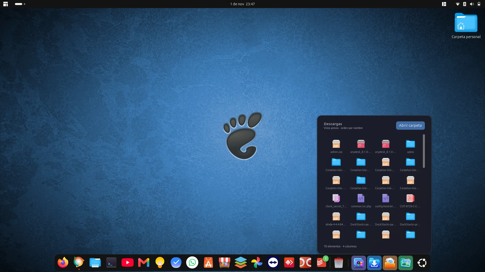
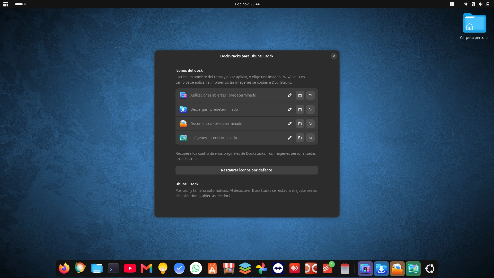
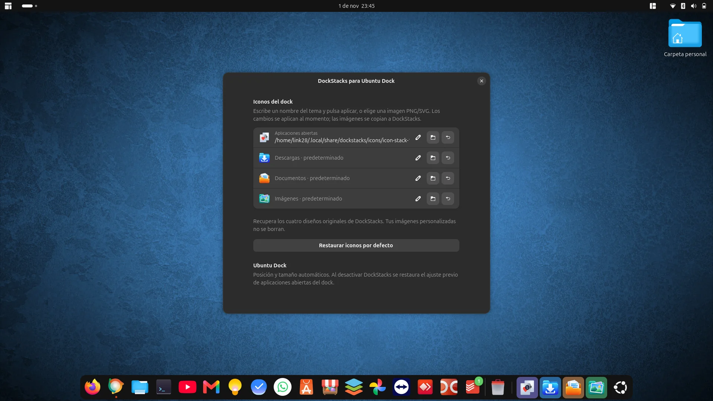

# DockStacks para Ubuntu Dock



**Versión 11 estable · GNOME Shell 50 · Ubuntu Dock**

Carpetas y aplicaciones abiertas, a un clic del dock. Integra un stack de aplicaciones y accesos a **Descargas, Documentos e Imágenes**, con paneles de cuatro columnas y desplazamiento vertical.

La base visual (versión 10) fue aprobada por Manuel después de las pruebas en su equipo Ubuntu 26.04.1 LTS con GNOME Shell 50.1. La compatibilidad con otras versiones de GNOME o docks no está confirmada. Proyecto comunitario independiente de Ubuntu y GNOME.

## Funciones

- **Aplicaciones abiertas:** contador por aplicación, activación de ventanas y selector por título cuando hay varias.
- **Clic derecho sobre una aplicación:** menú anclado al icono con **Cerrar aplicación**, manteniendo visible el stack. Solicita cierre normal, sin forzar la pérdida de documentos.
- **Nombres al pasar el ratón** por los controles del dock y las aplicaciones del stack.
- **Carpetas:** lista completa de elementos no ocultos, cuatro columnas, scroll y apertura con las aplicaciones predeterminadas.
- **Gestor visual:** instalar/actualizar, habilitar/deshabilitar, consultar estado y personalizar iconos.
- **Iconos propios:** identidad de DockStacks y cuatro diseños para aplicaciones, Descargas, Documentos e Imágenes.
- **Personalización:** nombres del tema o imágenes PNG/SVG, vista previa y aplicación inmediata.
- **Restaurar iconos por defecto:** recupera los cuatro diseños; también se puede restaurar cada fila por separado.
- El selector abre una subcarpeta del tema activo que contiene imágenes; reconoce temas del sistema y del usuario.

## Instalación y actualización

Descarga el proyecto mediante **Code → Download ZIP**, descomprímelo y abre una terminal en la carpeta:

```bash
bash instalar-visual.sh
```

Instala la extensión, el gestor y el icono, y crea **DockStacks** en el menú de aplicaciones. **Cierra sesión completamente y vuelve a entrar** para cargar el código nuevo. No basta con desactivar y volver a activar tras actualizar.

Después abre **DockStacks** desde el menú. Permite habilitar/deshabilitar la extensión y abrir **Personalizar iconos**. Para abrir la ventana gráfica desde la carpeta descargada:

```bash
bash abrir-instalador.sh
```

El gestor guarda una copia local de los archivos que necesita; después de instalar puedes eliminar la descarga. No ejecutes el instalador con sudo.

### Requisitos

- GNOME Shell **50** y Ubuntu Dock (`ubuntu-dock@ubuntu.com`) habilitado.
- Python 3, PyGObject, GTK 4 y libadwaita para el gestor.
- Si faltan dependencias gráficas:

```bash
sudo apt install python3-gi gir1.2-gtk-4.0 gir1.2-adw-1 libglib2.0-bin
```

Para instalar solo la extensión: `bash instalar.sh`. El UUID `carpetas-isla@manuel.local` se conserva desde las primeras versiones para actualizar instalaciones existentes.

## Actualizaciones desde GitHub

El gestor comprueba la última **Release estable** al abrirse y ofrece **Buscar actualizaciones**, **Ver cambios**, **Actualizar ahora** y **Más tarde**. No instala nada por su cuenta. No confunde cambios de `main`, borradores o versiones de prueba con publicaciones estables.

El interruptor **Revisar actualizaciones diariamente** es opcional y está **desactivado por defecto**. Activarlo configura un temporizador `systemd --user` que puede avisar aunque el gestor esté cerrado. Desactivarlo detiene el temporizador y cualquier revisión en curso. No necesita sudo. Puedes comprobar manualmente en cualquier momento.

**Actualizar ahora** descarga el paquete oficial, verifica el SHA-256 informado por GitHub, guarda un respaldo y conserva tus iconos, ajustes y estado de habilitación. Después pide cerrar el gestor y cerrar sesión. Si falla la instalación intenta restaurar los archivos anteriores. **Más tarde** pospone el aviso 24 horas; no impide una búsqueda o actualización manual.

El gestor muestra los fallos de conexión sin afirmar que está actualizado. Si no hay ninguna Release publicada o su paquete aún no está disponible, lo indica. La primera instalación del sistema de actualizaciones requiere descargar e instalar esta versión; después las versiones nuevas se ofrecen desde el gestor.

Consulta el [manual de botones](docs/MANUAL.md) y la [guía de publicación de Releases](docs/PUBLICAR-RELEASE.md).

## Uso y personalización

Pulsa el stack para ver las aplicaciones abiertas. Un clic activa la aplicación o permite elegir una ventana; el clic derecho ofrece **Cerrar aplicación**. Los favoritos siguen en el dock y las aplicaciones sin anclar se agrupan en el stack.

Pulsa una carpeta para explorar sus archivos. La rueda o la barra lateral permiten recorrer el contenido; **Abrir carpeta** abre el gestor de archivos. Escape o un clic fuera cierran el panel. Los iconos representan tipos de archivo; no son miniaturas del contenido.

En **Personalizar iconos**, elige un PNG/SVG o escribe el nombre de un icono del tema y pulsa aplicar. Las imágenes elegidas se copian a los datos de DockStacks para conservarlas aunque muevas el original. Los cambios se reflejan al momento.

**Restaurar iconos por defecto** recupera los cuatro diseños nuevos sin borrar tus imágenes ni modificar otros ajustes. Las personalizaciones anteriores se conservan al actualizar: pulsa el botón si quieres aplicar el conjunto nuevo.

## Capturas de la versión estable

Capturas reales facilitadas por Manuel, optimizadas a WebP.

### Cuatro iconos propios y restauración global



### Personalización aplicada al stack



### Exploración de Descargas


## Validación y alcance

El usuario confirmó el funcionamiento visual de la versión 10. La versión 11 añade el actualizador, con pruebas automatizadas y pendiente de comprobar el aviso real con la siguiente publicación. Durante las pruebas se comprobaron habilitación/deshabilitación, preferencias, selección y restauración de iconos, identidad de la aplicación, scroll y cierre de aplicaciones desde el stack.

Las pruebas automatizadas verifican agrupación y activación, restauración de preferencias del dock, reserva de espacio, iconos personalizados y predeterminados, búsqueda de carpetas de iconos, restauración global y mantenimiento del stack al abrir su menú contextual. También se revisan sintaxis, esquemas compilados, transparencia de los recursos e integridad de los paquetes.

Depende de estructuras internas de Ubuntu Dock; una actualización del dock puede requerir ajustes. Queda por ampliar la validación en varios monitores, escalado alto, orientación vertical, muchos favoritos y carpetas con miles de elementos. Consulta [limitaciones](docs/PROBLEMAS-CONOCIDOS.md).

## Desactivar o desinstalar

Usa **Deshabilitar** en el gestor, o:

```bash
gnome-extensions disable carpetas-isla@manuel.local
```

Para desinstalar solo la extensión:

```bash
gnome-extensions uninstall carpetas-isla@manuel.local
```

No elimina tus carpetas ni archivos personales. El gestor y sus imágenes permanecen en los datos de tu usuario. Al desactivar la extensión se restaura el valor de `show-running` guardado antes de agrupar las aplicaciones. No modifica archivos de Ubuntu Dock.

## Desarrollo

Código de la extensión en `extension/`; gestor en `dockstacks.py`. El ZIP instalable está en la raíz. Para reconstruirlo y ejecutar las pruebas:

```bash
python3 empaquetar.py
node tests/logica.mjs
node tests/icon-paths.mjs
```

Consulta el [historial de cambios](CHANGELOG.md) y las [notas de la versión 11](RELEASE-NOTES-v11.md).

Autor: Manuel Gonzalez. Código bajo [licencia MIT](LICENSE). Las capturas documentan interfaces y marcas de terceros, que conservan sus derechos. Los iconos propios fueron creados con asistencia de IA para DockStacks.
