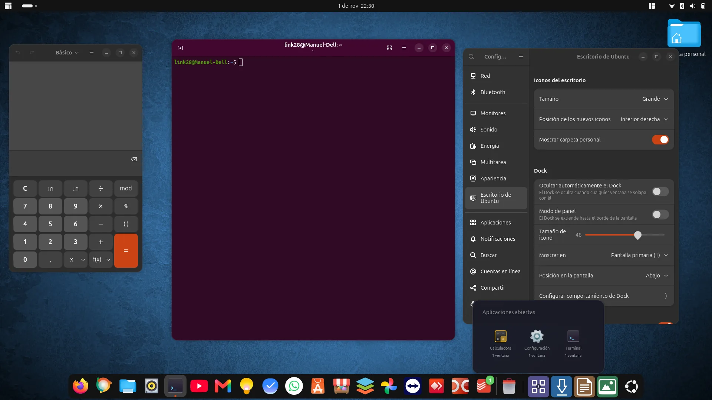
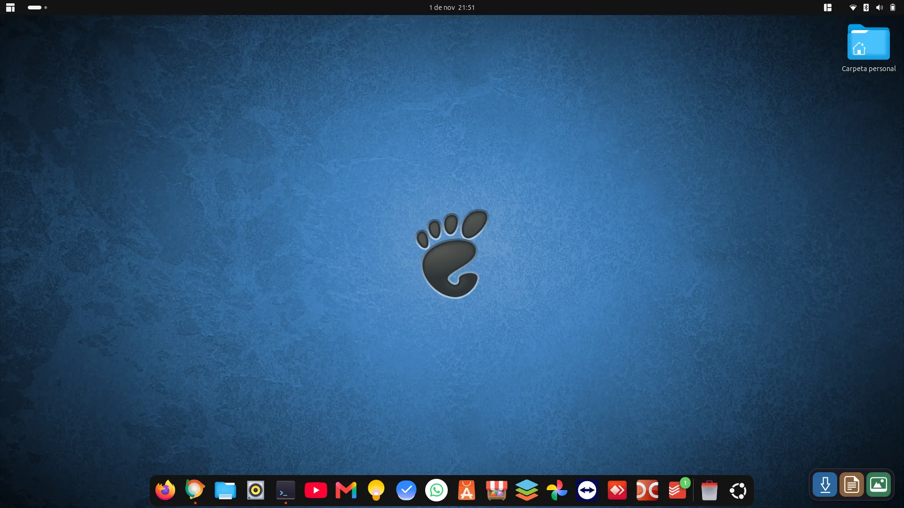
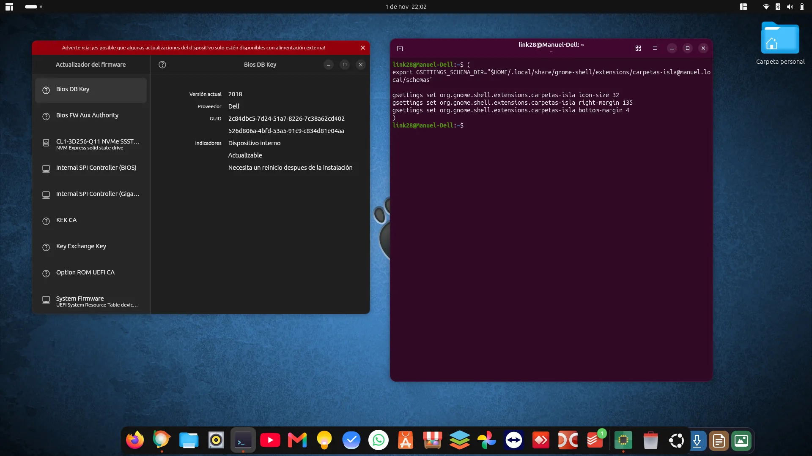
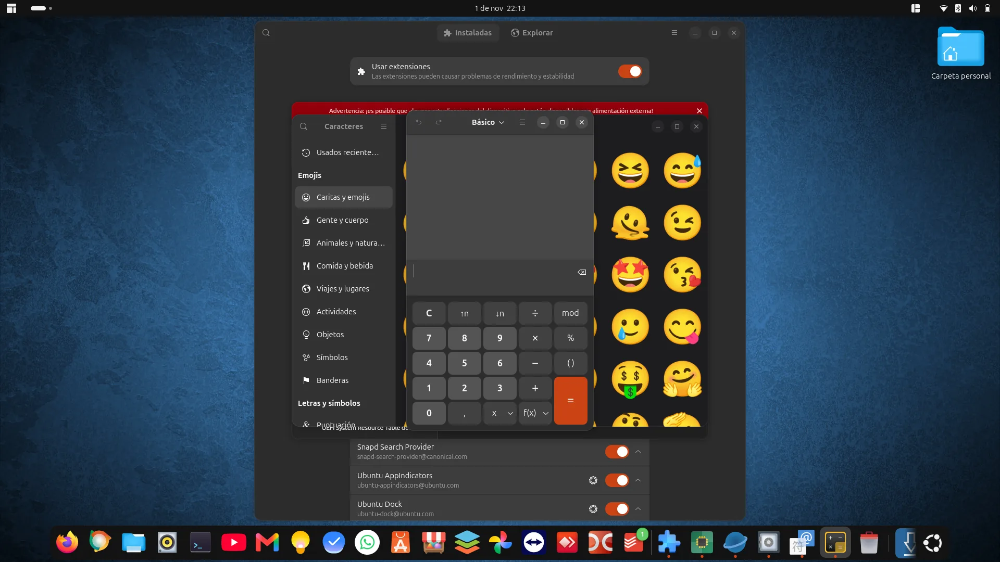
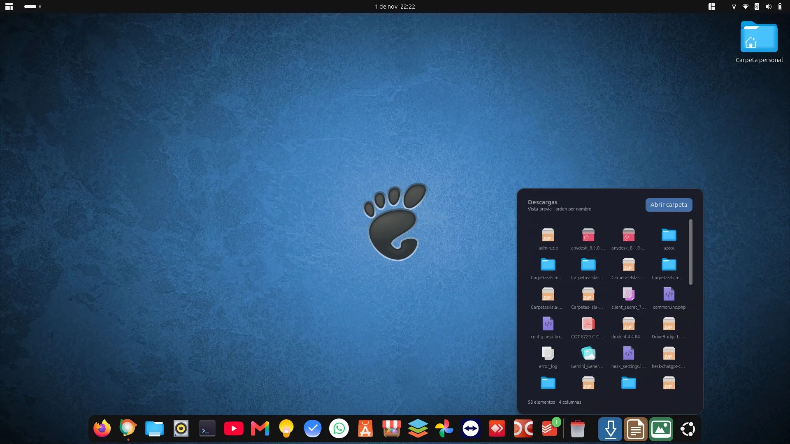
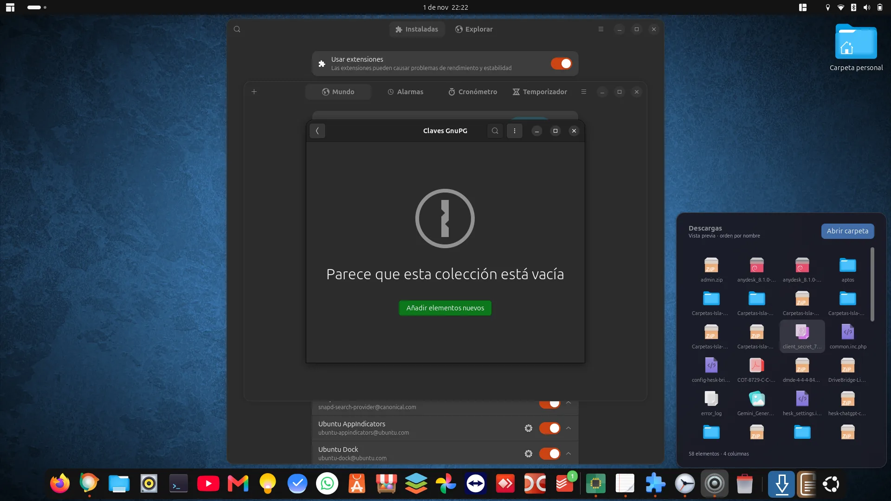

# DockStacks para Ubuntu Dock · GNOME 50



Extensión comunitaria que añade **Descargas, Documentos e Imágenes dentro de Ubuntu Dock**, separadas de las aplicaciones por una línea, junto a un **stack de aplicaciones abiertas**. Un clic abre un panel para explorar la carpeta y abrir archivos con sus aplicaciones predeterminadas.

El proyecto nació para reproducir el acceso a carpetas del dash de Luma en Ubuntu, conservando Ubuntu Dock. No es un componente oficial de Ubuntu, GNOME, Luma ni macOS.

Antes llamado **Carpetas Isla**. Se conserva el UUID `carpetas-isla@manuel.local` y el esquema de ajustes para actualizar instalaciones existentes.

## Funciones

- Versión 4: stack de todas las aplicaciones con ventanas, contador y selección de ventana cuando hay varias.
- Tres accesos a las carpetas personales, usando sus rutas XDG (también si sus nombres están traducidos).
- Panel con iconos y nombres en **cuatro columnas**, ordenado por nombre.
- Versión 3: desplazamiento vertical y listado completo de elementos no ocultos, sin el límite anterior de 12 elementos o 512 entradas leídas.
- Botón **Abrir carpeta** para acceder mediante el gestor de archivos predeterminado.
- Apertura de cada elemento con su aplicación predeterminada.
- Separador e integración dentro del contenedor del dock; tamaño de iconos sincronizado con el dock.
- Lectura asíncrona y construcción de iconos por lotes.

## Estado real de las pruebas

| Función | Estado |
| --- | --- |
| Paneles de carpetas y clics de la primera versión | Confirmados por el usuario |
| Integración en Ubuntu Dock, versión 2 | Confirmada por el usuario |
| Cuatro columnas y scroll completo, versión 3 | Confirmados por el usuario; captura con 58 elementos |
| Dock saturado por muchas aplicaciones | Corrección de espacio implementada en v4; pendiente de prueba visual |
| Stack de aplicaciones abiertas, versión 4 | Panel confirmado en captura real con tres aplicaciones; pruebas de lógica pasan. Selección entre varias ventanas pendiente |

No se presenta esta versión como una publicación estable o validada en múltiples equipos.

## Requisitos

- GNOME Shell **50**; equipo de referencia: Ubuntu 26.04.1 LTS, GNOME Shell 50.1.
- Extensión **Ubuntu Dock** (`ubuntu-dock@ubuntu.com`) habilitada.
- Instalación con el usuario normal, sin `sudo`.

Depende de la estructura interna de Ubuntu Dock (`dashtodockBoxContainer` y el objeto del dash). Una actualización del dock puede necesitar una adaptación. Se integra en el monitor principal. La compatibilidad con otras versiones de GNOME o con otros docks no está comprobada.

## Instalación y actualización

Descarga el proyecto mediante **Code → Download ZIP**, descomprímelo y abre una terminal en la carpeta que contiene `instalar.sh`:

```bash
bash instalar.sh
```

Después **cierra sesión completamente y vuelve a entrar**. Desactivar y activar la extensión puede dejar en memoria el módulo JavaScript anterior.

Si GNOME todavía no la reconoce durante la instalación, al volver a entrar ejecuta:

```bash
gnome-extensions enable carpetas-isla@manuel.local
```

La versión 4 guarda el valor previo de `show-running` y lo pone en `false` mientras está activa para evitar iconos individuales de aplicaciones sin anclar. Lo restaura al desactivar la extensión; la copia del valor anterior se guarda en GSettings para sobrevivir a reinicios o sesiones interrumpidas. No modifica archivos de Ubuntu Dock.

La actualización utiliza el mismo identificador y reemplaza la versión previa. No crea otra barra ni borra carpetas o archivos personales. Los ajustes de posición manual de la versión 1 ya no se utilizan.

## Uso

1. Pulsa Descargas, Documentos o Imágenes.
2. Desplázate con la rueda del ratón o la barra vertical si hay más elementos de los que caben.
3. Pulsa un elemento para abrirlo; utiliza **Abrir carpeta** para ver la carpeta completa en el gestor de archivos.
4. Pulsa fuera del panel o Escape para cerrarlo.

Los archivos ocultos no se incluyen. Se muestran iconos, no miniaturas del contenido.

## Stack de aplicaciones (versión 4)

El botón morado con cuadrícula, antes de Descargas, abre el panel de **Aplicaciones abiertas**. Su contador indica aplicaciones, no ventanas. Incluye todas las aplicaciones con ventanas visibles en el selector de tareas, también las favoritas y las de otros espacios de trabajo.

- Una ventana: al pulsar la aplicación, la activa.
- Varias ventanas: muestra sus títulos para elegir cuál activar.
- El panel usa cuatro columnas y desplazamiento vertical.
- El contenido se actualiza cada medio segundo mientras se muestra la lista de aplicaciones.
- Los favoritos permanecen en el dock; las aplicaciones sin anclar se agrupan en el stack.

La reserva de espacio de v4 coloca los controles fuera del área desplazable de las aplicaciones y descuenta su tamaño del cálculo de iconos del dock. La presentación con muchos favoritos o en configuraciones diferentes todavía necesita pruebas reales.

## Capturas del desarrollo

Son capturas reales facilitadas por Manuel, optimizadas a WebP. Documentan la evolución desde el prototipo hasta el stack de aplicaciones de la versión 4.

### Primera versión: bloque independiente



### Por qué se descartó la posición fija

El bloque se alineaba manualmente, pero no acompañaba al dock cuando aumentaba el número de aplicaciones.



### Integración y prueba de saturación

La versión 2 coloca las carpetas dentro del contenedor del dock. Esta captura también documenta la incidencia pendiente al abrir muchas aplicaciones: los accesos no conservan todo su espacio visible.



### Scroll confirmado en la versión 3

Cuatro columnas, barra de desplazamiento y contador de 58 elementos en Descargas, confirmados por el usuario.



### Stack de aplicaciones en la versión 4

Panel real con Calculadora, Configuración y Terminal; el contador muestra tres aplicaciones.


### Carpetas con varias aplicaciones abiertas



## Limitaciones y trabajo pendiente

- **Espacio del dock:** comprobar visualmente la nueva reserva de espacio de v4, especialmente con muchos favoritos.
- **Stack de aplicaciones:** implementado en v4; panel confirmado en captura; falta comprobar selección entre varias ventanas y actualización al cerrar aplicaciones.
- El scroll de v3 está confirmado; falta probar carpetas con miles de elementos.
- Verificar escalado de pantalla, varios monitores, posiciones verticales y ocultación automática.
- No incluye miniaturas, arrastrar y soltar ni operaciones de copiar, mover o borrar.

Consulta el [historial](CHANGELOG.md) y los [problemas conocidos](docs/PROBLEMAS-CONOCIDOS.md).

## Desactivar o eliminar

```bash
gnome-extensions disable carpetas-isla@manuel.local
```

```bash
gnome-extensions uninstall carpetas-isla@manuel.local
```

Esto no elimina las carpetas personales. La extensión no modifica archivos de Ubuntu Dock. Mientras está activa cambia temporalmente show-running y lo restaura al desactivarse.

Si cambiaste manualmente la opción de mostrar aplicaciones abiertas durante las pruebas, puedes restaurarla con:

```bash
gsettings set org.gnome.shell.extensions.dash-to-dock show-running true
```

## Desarrollo y empaquetado

El código se encuentra en `extension/`; el ZIP instalable está en la raíz. Para reconstruirlo después de editar:

```bash
python3 empaquetar.py
```

Para ejecutar las pruebas de lógica con Node.js: `node tests/logica.mjs`.

Validaciones realizadas: agrupación por aplicación, filtrado de ventanas, activación, restauración de preferencias y reserva de espacio (incluida restauración ante errores); sintaxis de los módulos JavaScript, sintaxis Bash del instalador, metadatos JSON, esquema XML e integridad de los ZIP. Son comprobaciones de empaquetado; no sustituyen una prueba dentro de GNOME Shell.

Autor del proyecto: Manuel Gonzalez. Código bajo [licencia MIT](LICENSE). Las capturas se incluyen con autorización de su autor para documentar el proyecto; la licencia del código no concede derechos sobre marcas o interfaces de terceros presentes en ellas.
