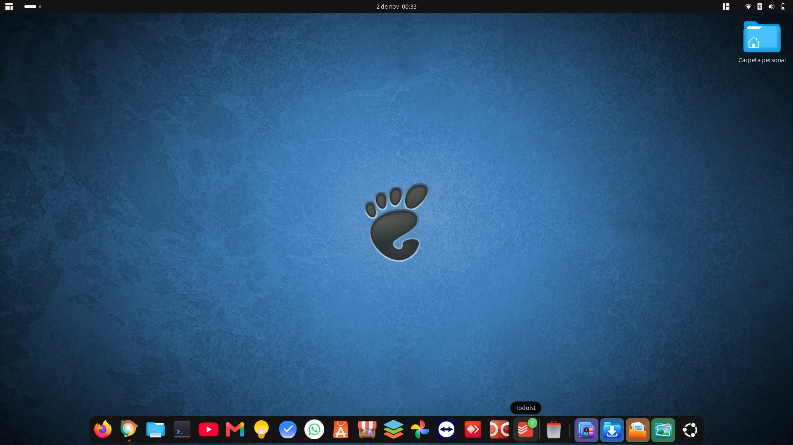
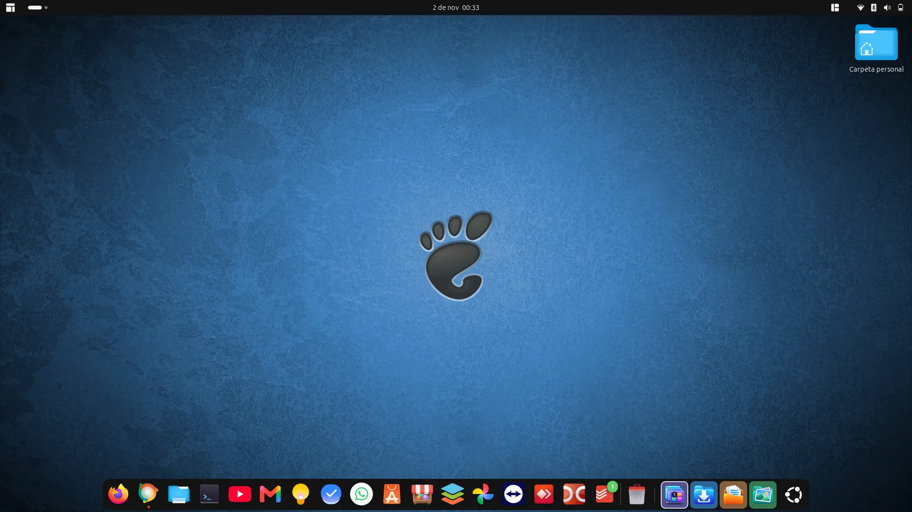
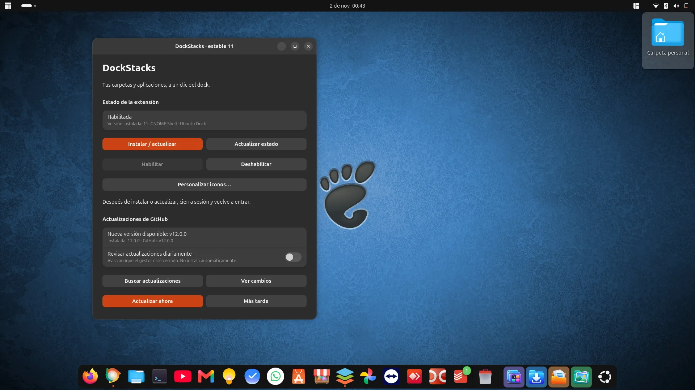
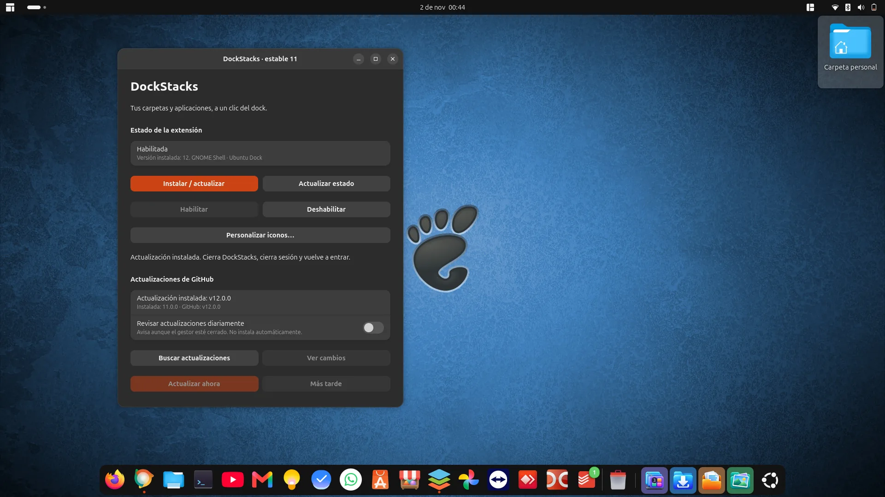
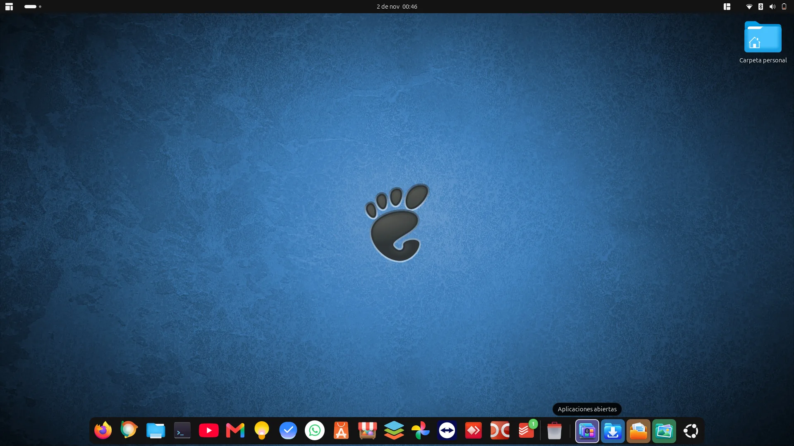
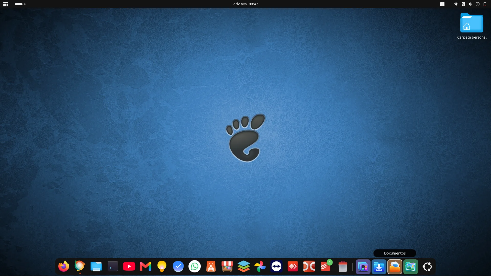

# Versión 12: títulos de los controles y prueba del actualizador

## Incidencia comunicada

En la versión 11, Todoist muestra su título al pasar el ratón, mientras los controles añadidos por DockStacks no muestran los suyos. Capturas del equipo de Manuel:

Estas imágenes documentan el estado anterior a la corrección; no son capturas del resultado de la versión 12.

## Implementación

- Etiqueta nativa `dash-label`, coherente con GNOME Shell.
- Registro como top chrome y elevación al mostrarla para evitar quedar debajo del dock.
- Medición del tamaño preferido antes de posicionar; no se usa el tamaño transformado cero de una etiqueta recién creada.
- Posición fuera del botón, limitada al monitor; contempla orientación horizontal y vertical.
- Seguimiento del botón propietario para que un evento de salida tardío del icono anterior no oculte el título actual.
- Ocultación y limpieza al retirar el puntero o destruir los controles.

## Plan de prueba en el equipo

Con DockStacks 11 instalado, usar Buscar actualizaciones → Ver cambios → Actualizar ahora. No instalar manualmente el ZIP para esta prueba, pues queremos comprobar el actualizador real.

Después de la confirmación, cerrar el gestor y cerrar sesión. Al volver a entrar, comprobar la versión 12 y pasar el ratón por Aplicaciones abiertas, Descargas, Documentos e Imágenes, tanto lentamente como moviéndose entre ellos. Comprobar que el título desaparece al salir del dock y que no tapa los iconos.

Verificar que se conservaron iconos personalizados, habilitación y la preferencia de revisión diaria. Registrar el resultado y añadir una captura posterior cuando el usuario lo confirme.

## Resultado disponible

Pruebas de lógica y empaquetado superadas. Actualización real 11 → 12 y visibilidad de los títulos después de cerrar sesión confirmadas por Manuel el 2 de noviembre de 2026.

## Evidencia del actualizador real — 2 de noviembre de 2026

Manuel confirmó que la versión 11 detectó v12.0.0 y completó la actualización desde el gestor, sin instalar un ZIP manualmente. Las capturas muestran la detección y la confirmación de instalación con la extensión 12 en disco.

La ventana sigue mostrando «estable 11» porque ese proceso continúa cargado hasta cerrarlo. La comprobación posterior al cierre de sesión se completó con éxito, como se documenta a continuación. La revisión diaria permanece desactivada en las capturas.

## Resultado final confirmado — 2 de noviembre de 2026

Manuel cerró sesión después de actualizar desde el gestor y confirmó el éxito de la prueba. Las capturas posteriores muestran los títulos nativos «Aplicaciones abiertas» y «Documentos» sobre los controles de DockStacks.

**Estado de la prueba: completada con éxito.** La detección, instalación desde el gestor, retorno a la sesión y corrección visual quedan documentadas. No se ha realizado una prueba adicional de notificación diaria, y la revisión automática sigue siendo opcional.
