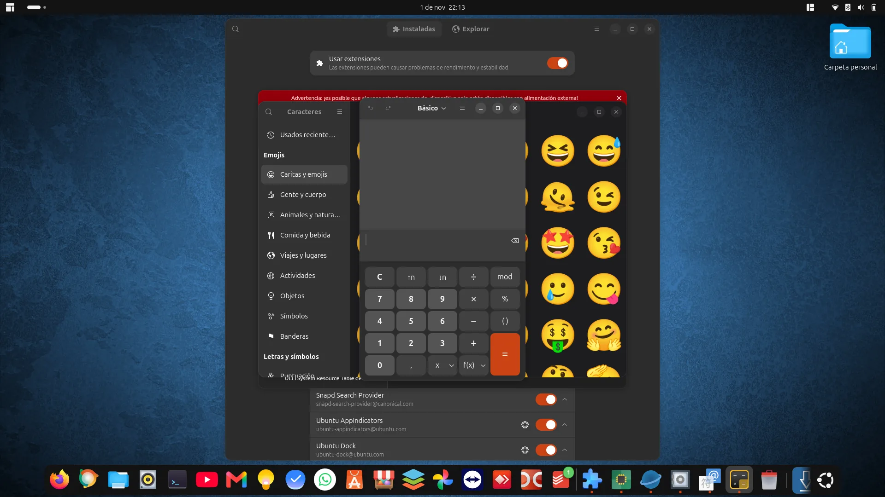

# Problemas conocidos y comprobaciones pendientes

## Accesos ocultos cuando el dock se llena

**Confirmado por el usuario en la versión 2. Persistía en la versión 3. La versión 4 incluye una corrección todavía pendiente de confirmación visual.**

Al abrir numerosas aplicaciones sin anclar, el dock incorpora sus iconos. El bloque de carpetas comparte su contenedor desplazable, pero el cálculo de espacio de Ubuntu Dock no reserva adecuadamente el ancho añadido. Algunos accesos pueden quedar ocultos cerca del botón de aplicaciones.



### Reproducción

1. Activar Ubuntu Dock y DockStacks.
2. Mantener un número elevado de favoritos.
3. Abrir suficientes aplicaciones adicionales para llenar la barra.
4. Comprobar que las tres carpetas siguen accesibles y no quedan ocultas.

### Corrección implementada en v4, pendiente de validación

Se colocan los controles fuera del área desplazable, se reserva su espacio en el cálculo de iconos y se limita el área desplazable de aplicaciones. Un stack agrupa las aplicaciones abiertas sin anclar. Falta comprobar el resultado en GNOME, especialmente con muchos favoritos.

### Alternativa temporal

Ocultar del dock las aplicaciones abiertas sin anclar:

```bash
gsettings set org.gnome.shell.extensions.dash-to-dock show-running false
```

Se puede cambiar entre aplicaciones con Alt+Tab. Para restaurar la opción:

```bash
gsettings set org.gnome.shell.extensions.dash-to-dock show-running true
```

Desde la versión 4 la extensión aplica show-running=false durante el uso del stack y restaura el valor previo al desactivarse. En v2 y v3 este ajuste era manual.

## Scroll de la versión 3

Confirmado por el usuario, con captura de 58 elementos en cuatro columnas y barra de scroll. Validar una carpeta con más de 12 elementos, llegar al último, abrir un archivo al final, cerrar el panel durante la carga y volver a abrirlo.

## Compatibilidad

Pendiente de verificar: varios monitores, escalado alto, posiciones verticales del dock, ocultación automática y carpetas con miles de entradas. No se promete compatibilidad con otro GNOME u otro dock.

## Stack de la versión 4

Implementado; pruebas de lógica satisfactorias. La apertura del panel morado está confirmada en captura con tres aplicaciones. Pendiente de probar selección de una aplicación con una ventana, selección por título si hay varias, actualización al cerrar aplicaciones y restauración del comportamiento previo del dock al desactivar la extensión.

## Gestor e iconos de la versión 5

Pendiente de prueba visual en Ubuntu/GNOME 50: abrir el gestor, instalar/actualizar, cerrar sesión y volver a entrar, comprobar el estado y habilitar/deshabilitar. Abrir Personalizar iconos, elegir PNG y SVG, aplicar un nombre de icono del tema y restaurar los cuatro valores originales. Comprobar también cancelación del selector y persistencia tras reiniciar. Las pruebas automatizadas verifican la selección del icono y el fallback cuando falta el archivo, no el renderizado GTK/GNOME.

Si se abre la personalización antes de cerrar sesión tras actualizar desde v4, pueden seguir cargadas las preferencias anteriores. Cierra sesión completamente para cargar el código y esquema de v5.
